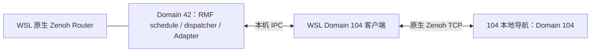

# 2026-10-18：广播自动接入

调度连接不再从配置读取车辆 IP，改由车端 UDP 广播发现并建立独立 ROS 域连接。car1/car2 保留为中央命名与顺序，不是固定地址入口。当前部署、启动和验证边界见 [广播接入说明](src/system/omnifleet_rmf_adapter/BROADCAST_DISCOVERY.md)。

# 当前双车协同（2026-10-17）

WSL 中央 Domain 42 已接入独立 Domain 104/113，由 central.assignments 分配中央前缀；共享图、同伴占用与不发车编队准备链路已接通，实车运动输出保持禁用。当前配置、启动与验收范围见 [当前模块说明](src/system/omnifleet_rmf_adapter/README.md)。

以下为 2026-10-14 单车阶段的历史设计与验收记录；其中 113 未启用、旧定位话题及仅两点图等描述不代表当前双车接入状态，历史实车结果不计作本轮验收。

---

# WSL OmniFleet 中央调度

2026-10-14 更新：ROS 2 Humble / 原生 `rmw_zenoh_cpp` 中央框架已接入 104 的 RMF 任务、导航 Action、取消与反馈。只有操作员登记当前建图会话并启用车队控制后才允许提交任务；不直接发布底盘速度，不依赖 MSC Agent。当前是单车有界验收版本，不是生产多车交通系统。

## 部署与通信域

| 进程 | ROS Domain | 通信 | 状态 |
| --- | --- | --- | --- |
| RMF traffic schedule、task dispatcher、OmniFleet Adapter | 42 | 原生 Zenoh，经 WSL `127.0.0.1:7447` Router | 运行 |
| WSL 104 导航接口客户端 | 104 | 原生 Zenoh，直连 `192.168.3.104:7447` | 已连接，操作员门控 |
| WSL 113 客户端 | 未确认 | 未启用 | 保留入口 |

Domain 42 与车辆 Domain 不直接混合；客户端经本机 Unix datagram socket 交换精简状态和任务命令。WSL Router 仅监听回环地址，没有连接车端 Router。104 客户端单独连接车端。



源码位于 `src/<功能域>/<包>`；业务配置在对应包的 `config/`；构建产物在 `build/`、`install/`、`log/`；运行状态、RMF 数据库和验收证据在 `data/`。

## 命名分配

唯一配置入口：`src/system/omnifleet_rmf_adapter/config/framework.json`。

- `central.assignments` 分配中央车辆名字和 Namespace；104 当前分配 `/robot_104`。
- `robots.robot_104.local_namespace` 为 `""`，表示目标车内接口不带车辆前缀。
- `observed_namespace` 已设为空。104 车端话题、Action 与 TF frame 已迁移到无车辆前缀名称，保留 Domain 104 和身份元数据。
- 当前仅导出 `/robot_104/rmf/connection_status` 及中央聚合状态，没有把车内全部话题或 Action 桥接到中央。
- Namespace 分配不改写车内 TF frame，也不桥接全部 ROS 图。当前 RMF 两点图直接采用 104 当前 SLAM 的 map 坐标，只在该定位会话内有效；尚未完成跨车地图配准。

当前车端接口为 `/navigation/execute` 和 `/navigation/stop`。后续任务适配不得绕过 `local_navigation` 调用内部 Nav2 或底盘。

## 运行

```bash
source ~/workspaces/omnifleet_ws/env.bash
systemctl --user status omnifleet-wsl-zenoh-router.service omnifleet-rmf.target
systemctl --user start omnifleet-rmf.target
systemctl --user stop omnifleet-rmf.target
```

Router 和 RMF target 已启用为 WSL 用户服务；用户 lingering 已启用。Windows 未启动 WSL 时，这些服务不会凭空运行。

```bash
cat ~/workspaces/omnifleet_ws/data/connection_status.json
journalctl --user -u omnifleet-rmf-adapter.service -u omnifleet-rmf-robot104.service -f
```

`transport_connected` 表示近期收到导航与控制状态；`online` 还要求近期收到定位位姿。缺少电量百分比时 `battery_soc` 为 null，仅记录实际电压。`dispatch_enabled` 需要已登记 RMF 车辆、定位会话一致及有效车队租约；更改框架配置中的历史验证标记不会直接启用运动。

本机操作接口：`http://127.0.0.1:8081/state`。Foxglove 的中央 RMF 面板使用该接口提交登记、启用、任务、取消和禁用命令，写入需要会话 token。HTTP 只监听回环，不能直接供远端访问。当前任务仅允许 origin 和 back_030 两个登记点，不能输入任意实车坐标。

## 已验证

- 中央包构建成功；16 项状态、任务提交/取消竞态及 RobotCommandHandle 契约测试通过，车端租约与仲裁 5 项测试通过。
- 原生 Zenoh 上 RMF schedule 注册查询、只读 RPC 活性检测与 Adapter 状态链正常。
- `/get_dispatches` 实际查询成功；当时 active / finished 均为 0。
- 中央任务链为 RMF RobotCommandHandle -> 本机 IPC -> Domain 104 原生 Zenoh 客户端 -> 无前缀 `/navigation/execute` 的 FLEET 模式。Action 接受、反馈、取消结果已实测。
- 中央域 42 与测试域 106 隔离。
- 停止 WSL 104 客户端后，约 3.5 秒状态过期；重新启动后通信恢复。此测试不等于车端断网停车验收。
- 104 的 Action / NavigationPoint 定义已直接获取并构建，SHA256 与车端一致。
- WSL：`rmw_zenoh_cpp 0.1.11`；104：带本地补丁的 `0.1.9`。状态、Action 接受及取消通过，不宣称全部 QoS 或原生 Zenoh 生产级冗余兼容。

证据：`data/evidence_20261014/`；准确安装版本：`package_versions.tsv`。

Humble 的 schedule heartbeat 使用 DDS liveliness QoS，不定时发送消息，见[上游实现](https://github.com/open-rmf/rmf_ros2/blob/humble/rmf_traffic_ros2/src/rmf_traffic_ros2/schedule/Node.cpp)。中央每 5 秒只读查询 schedule 参数，以实际响应检测活性；超过 15 秒未响应则状态失效。未启动 RMF 的 DDS heartbeat 冗余 monitor，尚未验证原生 Zenoh 下的冗余切换。

## 待完成

生产 RMF 导航图、104/113 地图坐标配准、行驶中断连制动验收、完整到点验收、多车会车与等待验收仍待完成；113 的有效域号尚未核对。104 的旧 Agent 服务已不存在且被 mask，旧 Coordinator 未运行。

RobotCommandHandle 已实现分段任务、ETA 和计划到点等待。登记图绑定定位会话；定位跳变或地图会话改变会取消并禁用控制。当前验收中多次定位跳变触发保护，尚未成功完成 RMF 后退 0.30 m 到点，不能引用下面的历史 LOCAL 模式成功作为中央 RMF 成功。

## 官方 Fleet Adapter 职责

- `rmf_fleet.LiveFleet` 通过官方 `Adapter.add_fleet()` 和 `FleetUpdateHandle.add_robot()` 注册车辆，不独立分配任务或生成交通计划。
- `rmf_fleet.CommandHandle` 实现官方 `RobotCommandHandle`，路径替换先撤销旧导航并等待停车；每个路径的完成回调只触发一次，到点等待遵循 RMF 计划时间。
- `control_client.NavigationClient` 实现官方模板中 RobotAPI 的车辆通信职责，通过独立 Domain 的原生 Zenoh 接入 local_navigation；没有 MSC Agent 转发层。
- 官方 `FleetUpdateHandle.set_update_listener()` 接收车队更新。Humble 2.1.8 的任务状态从官方 BroadcastClient 经本机 `127.0.0.1:8082` WebSocket 接收；此接口只接收状态，不接收控制命令。只有 RMF 的 completed/canceled/killed/failed 状态才能清除中央活动任务。路径完成不是整个任务完成。
- `rmf.requests` 中 cancel_issued 只表示 RMF 找到任务并发出取消；实际任务状态见 `rmf.task_states`，车端停车见控制状态的 nav_active、velocity 与 stopped_seconds，三者不能混用。
- 车辆执行结果从按 request_id 保存的历史读取，不依赖最后一条事件；Action 成功后仍需等待车端停止确认，再执行计划等待。
- 位置仅在定位有效、map frame 正确且定位会话一致时上报；图外位置使用官方 update_lost_position 接口。控制门失效、人工控制或急停时禁止提交和继续执行。

本轮只完善中央契约并静止核验，不新增实车运动验收，不修改定位参数或 Foxglove。上次实车验收证据继续保留，不能当作新版本全部运动行为已验证。

中央状态接收依赖固定的 websockets 10.4，隔离安装在 `install/omnifleet_rmf_adapter_vendor`，仅中央进程使用该目录；不替换其他工程的 Python 库。Ubuntu 自带 9.1 在本机 Python 3.10 下未通过实际 WebSocket 连接核验。重建运行环境时执行：

```bash
python3 -m pip install --target ~/workspaces/omnifleet_ws/install/omnifleet_rmf_adapter_vendor -r ~/workspaces/omnifleet_ws/src/system/omnifleet_rmf_adapter/deployment/requirements.txt
```

车端 local_navigation 实现接收端单调时钟 0.8 秒租约、服务器 nonce、递增序号及任务版本匹配。网络失联不能续租，过期撤销车队任务，不自动恢复。活动导航断连测试通过，但断连瞬间速度为零，只证明过期撤销和不自动恢复，未证明行驶中停车距离。

当前图只包含登记时的 origin 和沿当时朝向后退 0.30 m 的 back_030；不加载保存地图。虚拟充电锚点和单位电池模型仅用于 RMF 初始化，能耗规划关闭，没有实测 SOC，不支持充电或 docking。两点图不是 SLAM 自主生成的完整拓扑图，也不能在定位原点变化后复用。

本地 Foxglove 已实屏确认中央状态显示、控制禁用及单个 3D 视图。104 远端 Foxglove 面板代码已更新，连接中央所需 SSH 回环转发被自动批准审查拒绝（仅返回 blocked by policy）；远端到中央的面板连接未完成。用户随后明确暂不需要继续修改 Foxglove，因此停止面板调整与远端转发工作。

当前证据和车端源码备份：`data/rmf_control_20261014/`，包含 `cancel_acceptance.json`、`watchdog_acceptance.json`、`rmf_task_acceptance.json`。部署前车端备份：`/home/iecme/robot_backups/rmf_adapter_20261014/`。

## 104 命名与运动验收

2026-10-14：车端静止采样确认没有 `/robot_104/...` 话题或 Action；TF 使用 `map`、`odom`、`base_link`、`rslidar`，`map -> base_link` 连通，Nav2 激活、本地安全控制门就绪。原 Nav2 数值参数与定位融合参数保留。

授权的本地导航测试：前进 0.30 m 目标在 25 秒内未到点，测得位移约 0.177 m；取消后停车，参数恢复。后退 0.30 m 目标返回 `SUCCEEDED`，融合位姿测得位移 0.3066 m，最大下发线速度幅值约 0.1043 m/s；停车确认、运行参数恢复通过。速度设定为 0.10 m/s，实际下发存在小幅超出，不宣称严格 0.10 m/s 上界或实物尺量精度。

上述历史测试客户端运行在 104 车端，通过无前缀 `ExecuteNavigation` 的 LOCAL 模式验证执行链，不是本轮 RMF 任务验收；不能用于替代中央到点验收。

车端备份与证据：`/home/iecme/robot_backups/no_vehicle_prefix_20261014/`；WSL 副本：`data/robot104_migration/no_vehicle_prefix_20261014/`。`motion.json` 保留前进失败，`motion_reverse.json` 保存后退成功，`final_static.json` 保存最终停车和命名检查。旧 Foxglove 客户端的若干旧名称在车端入口映射为本地无前缀名称，运行 ROS 图不暴露旧车辆前缀。

当前以原生 Zenoh + 自定义客户端接入，不安装 `zenoh-bridge-ros2dds`。参考：[Humble Fleet Adapter 模板](https://github.com/open-rmf/fleet_adapter_template/tree/humble)、[原生 RMW Zenoh Domain 设计](https://github.com/ros2/rmw_zenoh/blob/rolling/docs/design.md)、[RobotCommandHandle 路径执行契约](https://github.com/open-rmf/rmf_ros2/blob/humble/rmf_fleet_adapter/include/rmf_fleet_adapter/agv/RobotCommandHandle.hpp)。
